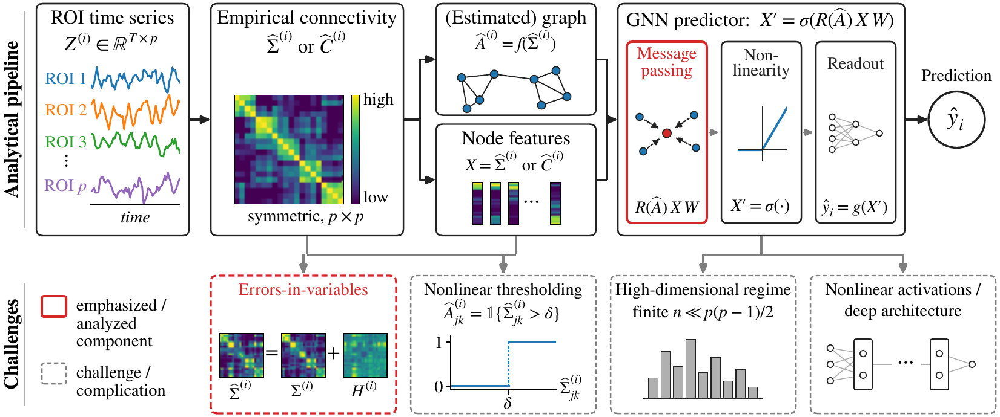

<div align="center">

# Bias, Measurement Error, and Double-Dipping

### When Can GNN Convolutions Help Brain Connectome Prediction?

Tommaso Castellani · Jiaqi Li · Muriah D. Wheelock · Rezwana Rosen Razzaque · Helmut Laufs · Hong Chen · Claire Donnat

**NeurIPS 2026**

[](https://arxiv.org/abs/XXXX.XXXXX)
[](https://neurips.cc/Conferences/2026)
[](https://www.python.org/downloads/)
[](https://pytorch.org/)
[](https://pyg.org/)
[](LICENSE)

</div>

<p align="center">
  
</p>

<p align="center"><sub><b>Figure 2.</b> Brain connectome GNN pipeline and statistical challenges. Top: the standard analytical pipeline, from ROI time series to prediction. Bottom: statistical challenges induced by the pipeline. The errors-in-variables component (red) is analyzed in the paper; the remaining challenges (gray, dashed) are left to future work.</sub></p>

## Overview

Graph neural networks on fMRI connectomes often fail to beat simple models that ignore the graph. The paper explains this with an errors-in-variables view. The true connectome $\Sigma$ of a subject is latent, and the observed covariance $\widehat\Sigma = \Sigma + H$ is a noisy estimate from $T$ time points. The same noisy matrix gives both the node features and the graph. A graph convolution then has three effects:

1. **Graph smoothing.** Averaging over neighbors adds bias and removes variance, even with the true (oracle) graph.
2. **Graph estimation error.** The graph is estimated from finite data, so some edges are wrong.
3. **Double dipping.** When one sample builds both the graph and the features, their errors are coupled.

Under a latent community model, convolution helps only in a narrow regime set by the community structure, the predictive signal, the graph threshold and the recording length. Simulations confirm the decomposition, and real-data experiments show that standard connectome pipelines usually sit outside this regime.

This repository contains all the code for the simulations, the real-data experiments, and every figure and table of the paper.

## The five feature maps

Every experiment compares the same five feature maps. They differ only in the graph $A$ used by the convolution $R(A)\widehat C$, where $R(A) = \widetilde D^{-1}(A + I)$ is the SageMean operator.

| Paper | Real data (`--adjacency`) | Simulations | Graph built from |
|---|---|---|---|
| $\widehat C$ | `none` | `Estimated` | no graph (no convolution) |
| $A^{\text{oracle}}$ | `bar` | `bar` | the true connectome (simulations) or the full scan (real data) |
| $A^{\perp}$ | `circle` | `circle` | a second, independent estimate of the same connectome (on real data, a separate window of the same subject) |
| $\widehat A$ | `window` | `hat` | the same window that gives the features (the standard pipeline) |
| $A^{\text{pop}}$ | `zero` | `note` | the training-set mean connectome, shared by all subjects |

The three effects are gaps between them: smoothing is $A^{\text{oracle}} - \widehat C$, graph estimation error is $A^{\perp} - A^{\text{oracle}}$, and double dipping is $\widehat A - A^{\perp}$.

## Repository layout

```
B-ME-DD/
├── simulations/
│   ├── run_simulations.py          latent community model, OLS on every feature map
│   └── simulate_utils.py           connectome, time series and target generators
├── real_data/
│   ├── benchmark/
│   │   ├── run_experiment.py       one real-data run (entry point)
│   │   ├── training.py             Lightning training with Optuna or frozen hyperparameters
│   │   ├── models.py               GNN, MLP and linear models
│   │   ├── neurograph.py           ResidualGNN (adapted from NeuroGraph)
│   │   └── BrainGNN_Pytorch/       BrainGNN (vendored)
│   ├── shared/                     windowing, targets, graphs, subject splits, scoring
│   ├── utils/                      dataset loaders, registries, parcellation mappings
│   └── parcellation/               atlas files and cached ROI-to-network maps
├── utils/                          thresholding, convolution operators, plot style
├── experiments/
│   ├── make_jobs.py                the commands behind every figure and table
│   ├── run_jobs.py                 parallel runner that resumes interrupted grids
│   └── hparams/                    frozen hyperparameters of the controlled experiments
├── plots/
│   ├── plot_simulations.py         Figures 3 to 9
│   ├── plot_benchmark.py           Figure 1
│   └── make_tables.py              Tables 2 and 5 to 9, in Markdown and LaTeX
└── tests/
```

## Installation

The code was run with Python 3.11 and the package versions in `requirements.txt`.

```bash
git clone https://github.com/tommicaste/B-ME-DD.git
cd B-ME-DD
uv venv --python 3.11
source .venv/bin/activate
uv pip install -r requirements.txt
uv pip install -e .
```

Plain `pip` works the same way. The simulations run on CPU; they compile the convolution operators with `torch.compile`, which needs a C++ compiler (for example `g++`). The real-data experiments use a GPU when one is available. Run every command below from the repository root.

## Quick start

One seed of the four simulation runs behind Figures 3 and 5. Each run takes about 15 minutes on a multi-core CPU:

```bash
python experiments/make_jobs.py quickstart > jobs_quickstart.txt   # 4 simulation runs
python experiments/run_jobs.py jobs_quickstart.txt --workers 2
python plots/plot_simulations.py              # figures/fig3_main_sigma.pdf and fig5_main_correlation.pdf
```

## Data

The simulations need no data. The real-data experiments use three resting-state fMRI datasets. All loaders look under `./data`; set `BMEDD_DATA_DIR` or pass `--data_dir` to use another location.

| Dataset | Access | Expected layout |
|---|---|---|
| ABIDE ([Preprocessed Connectomes Project](http://preprocessed-connectomes-project.org/abide/)), C-PAC, band-pass filtering, global signal regression | public; downloaded by nilearn on the first run | `data/abide/` |
| ADHD-200 ([Neuro Bureau, Athena pipeline](http://preprocessed-connectomes-project.org/adhd200/)), CC200 time series | public; download `ADHD200_CC200_TCs_filtfix.tar.gz` and extract it into `data/adhd/cc200/` | `data/adhd/adhd200_preprocessed_phenotypics.tsv`<br>`data/adhd/cc200/<site>/<subject>/sfnwmrda*_cc200_TCs.1D` |
| Frankfurt EEG-fMRI sleep data ([Tagliazucchi et al., 2012](https://doi.org/10.1016/j.neuroimage.2012.06.036)) | on request from the data owners | `data/frankfurt/wheelock_ts/*_ptseries_294.mat`<br>`data/frankfurt/wheelock_hypnogram/*_AASM_hypnogram.txt`<br>`data/frankfurt/participants.csv` |

## Reproducing the paper

Every figure and table follows the same three steps: write the command list, run it, then plot.

```bash
python experiments/make_jobs.py abide > jobs_abide.txt   # 400 commands
python experiments/run_jobs.py jobs_abide.txt --workers 8
python plots/make_tables.py                               # tables/table2_abide.md and .tex
```

`run_jobs.py` skips every command whose result file already exists, so an interrupted grid resumes where it stopped. The command lists are plain text, one command per line, so they can also be sent to a cluster scheduler.

| Paper | Experiment | Runs | Output |
|---|---|---:|---|
| Figure 1 | `benchmark` | 150 | `python plots/plot_benchmark.py` |
| Figures 3 to 9 | `simulations` | 60 | `python plots/plot_simulations.py` |
| Table 2 | `abide` | 400 | `python plots/make_tables.py` |
| Table 5 | `relaxation` | 1,200 | `python plots/make_tables.py` |
| Table 6 | `gat` | 800 | `python plots/make_tables.py` |
| Table 7 | `adhd` | 1,000 | `python plots/make_tables.py` |
| Table 8 | `frankfurt` | 1,000 | `python plots/make_tables.py` |
| Table 9 | `density` | 640 | `python plots/make_tables.py` |

`python experiments/make_jobs.py all` writes every real-data command at once. Table 9 reuses the no-convolution arm of `abide`, which does not depend on the graph density.

### What the experiments do

**Simulations** (`simulations/run_simulations.py`). Connectomes come from a latent community model with $p=20$ regions in $K=5$ balanced communities. For each subject a time series of length $T$ gives $\widehat\Sigma$ and $\widehat C$, and each feature map is fit by OLS with an intercept on standardized features ($n=25{,}000$ subjects, 80/20 split). The coefficient patterns range from favorable to graph smoothing (`community_aligned`, `single_community_aligned`) to unfavorable (`within_community_contrast`, `edge_specific`). Curves report the test MSE divided by the test MSE on the true connectome, over 5 seeds.

**Controlled real-data experiments** (Tables 2 and 5 to 9). Each scan is cut into windows of length $T$; the window correlation matrix gives the features and the graph. One convolution, a density $\tau = 0.10$, hyperparameters frozen per dataset (`experiments/hparams/`), early stopping on the validation loss, a 60/20/20 split by subject, and 20 seeds. The simulation-like setting uses an identity activation, a vectorized readout and the same number of windows at every $T$; the deployed setting uses ReLU, mean pooling and every available window. Scores are subject-level for ABIDE and ADHD and window-level for Frankfurt, and the stars are paired $t$-tests over seeds.

**Benchmark** (Figure 1). Random forest, linear model and SVM (grid search on the validation split) against MLP, GAT, GCN, SAGE and ResidualGNN (Optuna on the validation split), on ABIDE age, ADHD diagnosis and Frankfurt sleep, with 10 seeds.

### Running a single configuration

`run_experiment.py` runs one configuration and appends one JSON row per model to `<out_dir>/<dataset>_<task>_seed<seed>.jsonl`. For example, the same-window graph on ABIDE at $T=25$:

```bash
python -m real_data.benchmark.run_experiment \
    --dataset abide --task classification --target DX_GROUP --parcellation rois_ho \
    --cohort_source_T 50 --model gnn --conv_type sage --num_convs 1 \
    --time 25 --n_mode fixed --readout vec --activation identity \
    --tau 0.10 --adjacency window --es_monitor val_loss --patience 25 --batch_size 64 \
    --fixed_params experiments/hparams/abide_rois_ho_classification.json \
    --seed 1 --out_dir outputs/example
```

Each row records the full configuration, the git commit, and the test metrics at window and subject level. `python -m real_data.benchmark.run_experiment --help` lists every option.

## Tests

```bash
pytest tests
```

## Citation

```bibtex
@inproceedings{castellani2026bias,
  title     = {Bias, Measurement Error, and Double-Dipping: When Can {GNN} Convolutions Help Brain Connectome Prediction?},
  author    = {Castellani, Tommaso and Li, Jiaqi and Wheelock, Muriah D. and Razzaque, Rezwana Rosen and Laufs, Helmut and Chen, Hong and Donnat, Claire},
  booktitle = {Advances in Neural Information Processing Systems},
  year      = {2026}
}
```

## Acknowledgments

`real_data/benchmark/neurograph.py` adapts the ResidualGNN of [NeuroGraph](https://github.com/Anwar-Said/NeuroGraph) (Said et al., 2024), and `real_data/benchmark/BrainGNN_Pytorch/` vendors [BrainGNN](https://github.com/xxlya/BrainGNN_Pytorch) (Li et al., 2021). We thank the ABIDE, ADHD-200 and Preprocessed Connectomes Project teams for making their data public.

## License

Released under the [MIT License](LICENSE).
